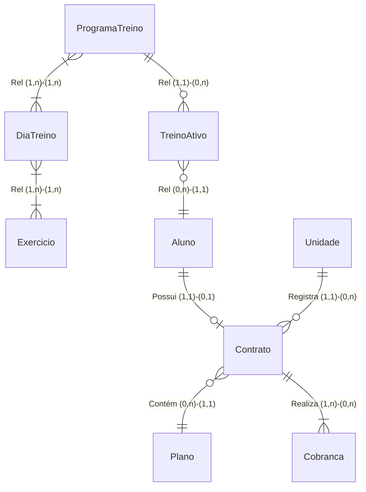

# Diagrama Conceitual — Sistema de Academia

Diagrama Entidade-Relacionamento (modelo conceitual) representando as entidades e seus relacionamentos com cardinalidades.

## Cardinalidades

| Relacionamento | Entidade A     | Card. A | Card. B | Entidade B     |
|----------------|----------------|---------|---------|----------------|
| Rel            | ProgramaTreino | (1, 1)  | (0, n)  | TreinoAtivo    |
| Rel            | ProgramaTreino | (1, n)  | (1, n)  | DiaTreino      |
| Rel            | DiaTreino      | (1, n)  | (1, n)  | Exercicio      |
| Rel            | TreinoAtivo    | (0, n)  | (1, 1)  | Aluno          |
| Possui         | Aluno          | (1, 1)  | (0, 1)  | Contrato       |
| Contém         | Contrato       | (0, n)  | (1, 1)  | Plano          |
| Registra       | Unidade        | (1, 1)  | (0, n)  | Contrato       |
| Realiza        | Contrato       | (1, n)  | (0, n)  | Cobrança       |

## Entidades

- **ProgramaTreino** — combinação fixa de nível de experiência e frequência semanal (12 programas no total)
- **DiaTreino** — sessão de treino dentro de um programa, com nome e ordem sequencial
- **Exercicio** — entidade global com nome e musculatura alvo; configurações de séries/repetições ficam na associação
- **TreinoAtivo** — vínculo entre aluno e programa em vigor; encerrado ao atualizar perfil do aluno
- **Aluno** — dados cadastrais, físicos e de perfil de treino (experiência e frequência semanal)
- **Unidade** — unidade física da rede, identificada por nome, endereço e CNPJ
- **Contrato** — vínculo formal aluno-plano-unidade com datas de vigência e status
- **Plano** — modalidade predefinida (diário, mensal, trimestral, semestral, anual) com valor e desconto progressivo
- **Cobrança** — registro financeiro gerado automaticamente no momento da criação do contrato
