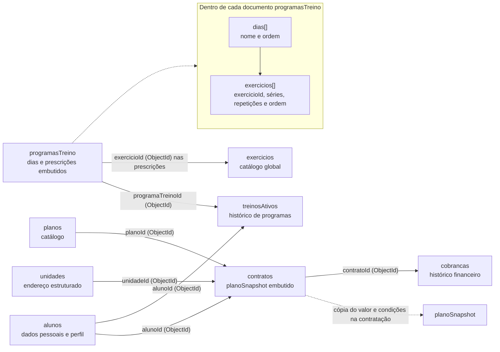

# Modelo documental MongoDB — Gestão de Academia

Este modelo traduz as entidades do domínio de BD1 para documentos MongoDB. Ele é uma proposta de persistência independente da API atual, que continua usando PostgreSQL.



## Decisões de modelagem

- **Embutir dados que são lidos juntos e têm limite conhecido:** cada `programasTreino` contém seus dias e as prescrições de cada exercício. Séries, repetições e ordem pertencem à prescrição, não ao exercício global.
- **Referenciar dados compartilhados:** programas apontam para `exercicios`; contratos apontam para `alunos`, `unidades` e `planos`. Isso evita duplicar o catálogo global de exercícios e mantém os documentos independentes.
- **Separar históricos que podem crescer sem limite:** `contratos`, `cobrancas` e `treinosAtivos` são coleções próprias, referenciadas por `ObjectId`, em vez de arrays sem limite dentro de aluno ou contrato.
- **Preservar o valor contratado:** `contratos.planoSnapshot` guarda tipo, valor, duração e desconto vigentes no momento da contratação; uma alteração futura no catálogo de planos não reescreve o histórico financeiro.
- **Validar e consultar com índices:** validadores `$jsonSchema` verificam os campos e tipos; índices únicos protegem CPF/e-mail, CNPJ, plano e programa. Índices adicionais atendem buscas por contrato e cobrança, e um índice parcial impede mais de um treino ativo por aluno.
- **Datas e valores:** datas são BSON `Date`; valores monetários são `Decimal128`, evitando imprecisão de ponto flutuante.

## Como criar e conferir

O script `database/mongodb/modelagem.js` cria o banco `gestao_academia`, as oito coleções, seus validadores e índices, além de documentos sintéticos para demonstração. Ele pode ser executado novamente: atualiza os validadores e os índices e cria os exemplos somente se ainda não existirem. Não apaga coleções ou documentos.

Use uma URI fornecida para um cluster de desenvolvimento; não grave credenciais no repositório:

```bash
export MONGODB_URI='mongodb+srv://<usuario>:<senha>@<cluster>/?retryWrites=true&w=majority'
mongosh "$MONGODB_URI" --file database/mongodb/modelagem.js
```

O script termina com verificações de leitura dos exemplos. Para inspecionar o resultado:

```javascript
const academia = db.getSiblingDB("gestao_academia");
academia.getCollectionNames().sort();
academia.alunos.findOne({ email: "aluno.demo@example.test" });
academia.programasTreino.findOne({ frequenciaSemanal: 3 });
academia.cobrancas.find({ status: "PENDENTE" });
academia.alunos.getIndexes();
academia.treinosAtivos.getIndexes();
```

Os exemplos são fictícios e não representam alunos reais. Para verificar a validação, tente inserir em `alunos` um documento sem os campos obrigatórios: o MongoDB deve rejeitá-lo com erro de validação. Para testar a unicidade, tente repetir um CPF ou e-mail existente: o índice deve rejeitar a duplicata.
