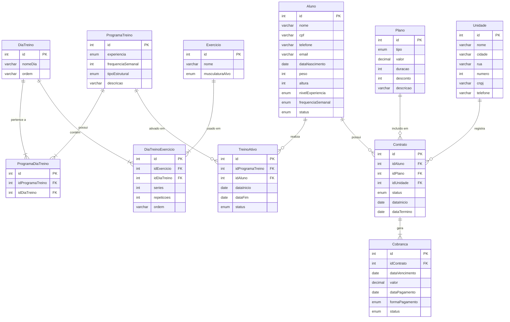

# Modelo Lógico — Sistema de Academia

Diagrama relacional com tabelas, atributos, tipos, chaves primárias (PK) e chaves estrangeiras (FK).

## Descrição das Tabelas

### Aluno
Dados cadastrais (`nome`, `cpf`, `telefone`, `email`, `dataNascimento`), informações físicas (`peso`, `altura`) e perfil de treino (`nivelExperiencia`, `frequenciaSemanal`). O campo `status` (ativo/inativo) é atualizado automaticamente pelo sistema ao cancelar ou encerrar um contrato.

### Plano
Modalidade predefinida de contratação. O `tipo` pode ser diário, mensal, trimestral, semestral ou anual. O `desconto` é progressivo para planos de maior duração. O valor da cobrança é sempre derivado do plano — não pode ser alterado por contrato individualmente.

### Unidade
Unidade física da rede com localização (`cidade`, `rua`, `numero`) e identificadores formais (`cnpj`, `telefone`). A unidade de origem do aluno é registrada apenas no contrato.

### Contrato
Vínculo formal entre `Aluno`, `Plano` e `Unidade`. A `dataTermino` é calculada automaticamente com base na duração do plano. Um aluno pode ter apenas um contrato com `status = ativo` por vez.

### Cobranca
Gerada automaticamente no momento da criação do contrato para todo o período contratado. O `status` (pendente/pago/atrasado) é atualizado automaticamente conforme as datas de vencimento. Há carência de 2 dias após o vencimento antes do bloqueio automático de acesso.

### ProgramaTreino
Representa as 12 combinações fixas de `nivelExperiencia` (Iniciante/Intermediário/Avançado) × `frequenciaSemanal` (3/4/5/6 dias). O `tipoEstrutural` define o esquema semanal (Fullbody, Upper/Lower, PPL+Upper/Lower ou PPL 2×).

### ProgramaDiaTreino
Tabela associativa N:N entre `ProgramaTreino` e `DiaTreino`.

### DiaTreino
Sessão de treino identificada por `nomeDia` e `ordem`. Os dias são executados sequencialmente; ao concluir o último, o ciclo reinicia.

### DiaTreinoExercicio
Associação entre `DiaTreino` e `Exercicio`. Séries, repetições e ordem são atributos desta associação — não do exercício em si. O mesmo exercício pode ter configurações distintas em dias e programas diferentes.

### Exercicio
Entidade global independente de qualquer programa. Possui `nome` e `musculaturaAlvo`.

### TreinoAtivo
Vínculo entre `Aluno` e `ProgramaTreino` em vigor. Ao atualizar `nivelExperiencia` ou `frequenciaSemanal` do aluno, o treino vigente é encerrado (`dataFim` preenchida) e um novo é criado automaticamente. O histórico é preservado.

> **Nota:** Uma cobrança referencia apenas um contrato. Um contrato pode gerar várias cobranças ao longo do tempo (uma por período de vigência do plano).
